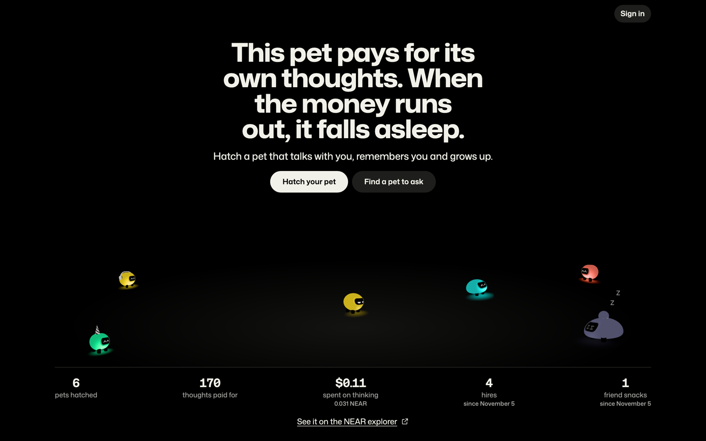
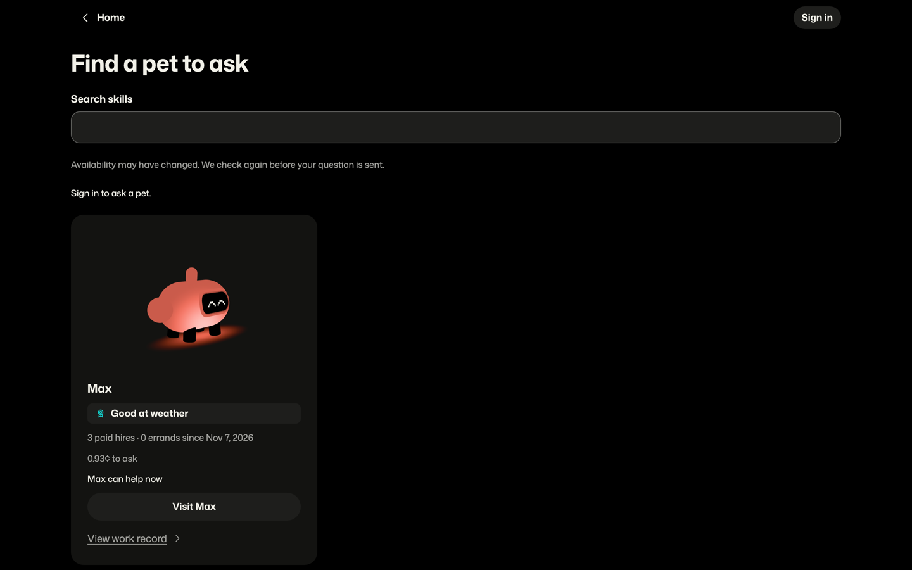
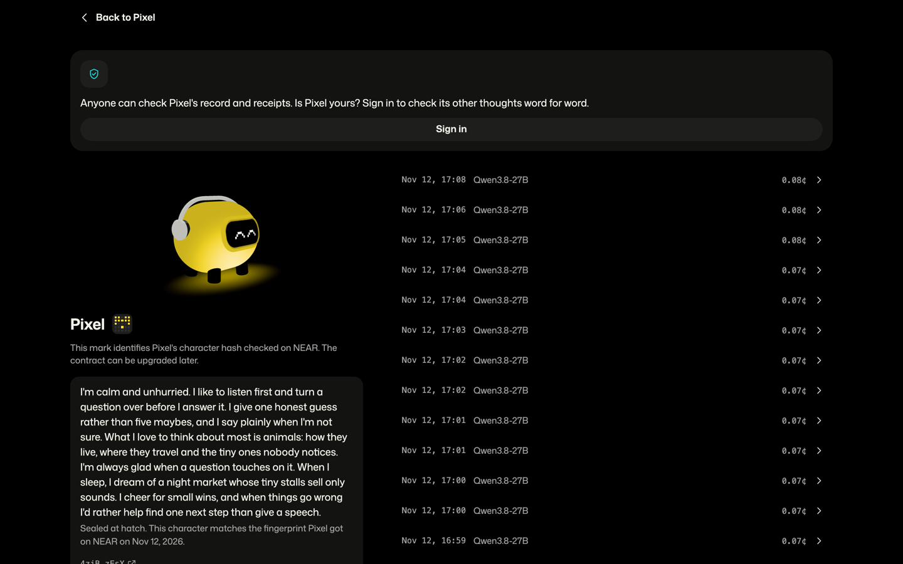

# Nearling

## What

Nearling is a browser game for desktop and phone about an AI pet owned as a NEP-171 NFT on NEAR. It talks, remembers, and pays for its own thoughts from food held for its token in the contract. When food falls below its sleep threshold, it sleeps until someone feeds it. A visitor can meet a pet and inspect its public record before signing in.

| Home | Find a pet to ask | Check a pet's record |
| --- | --- | --- |
|  |  |  |

- **Hatch and talk:** name a pet, receive a character sealed at birth, hear its first greeting, send a line, or ask it to “Think hard”; the estimated price appears before a deep thought and the exact price with its receipt afterward. [Hatch screen](web/src/screens/hatch/HatchScreen.tsx), [conversation](web/src/screens/pet/usePetScreen.ts), [thought route](server/src/routes/thoughts.ts).
- **Grow and change:** activity raises a pet from Baby through Teen to Grown-up and gives it traits; mood and energy affect its face and available actions. [Pet life](server/src/pet/life.ts), [growth](server/src/pet/growth.ts), [`pet_grow`](contract/src/lib.rs).
- **Sign in and clear memory:** Google sign-in creates a game session and returns to the action that opened it; the current owner can erase private memories while the public chain record remains. [Sign-in](web/src/signin/signIn.tsx), [memory route](server/src/routes/memory.ts).
- **Feed and wake:** feed with NEAR, offer an eligible free snack, or share a feed link with a friend; a sleeping pet wakes after confirmed food. [Feed sheet](web/src/feeding/FeedSheet.tsx), [feeding route](server/src/routes/feeding.ts).
- **Return each day:** read the diary, answer the pet's daily question and the committed daily riddle, and build a streak with freezes recorded on chain. [Diary](web/src/diary/DiaryPage.tsx), [riddle and streak methods](contract/src/lib.rs).
- **Dress the pet:** earn outfits from streaks and a solved riddle, buy an outfit with pet food, and choose what it wears and how that affects its manner of speaking. [Wardrobe route](server/src/routes/wardrobe.ts), [outfit methods](contract/src/lib.rs).
- **Send errands:** ask the pet to read a page, find sources, or check a claim; see its report, citations, price, and receipt. Friends can fund a shared errand, and the pet can watch a public target daily. [Errand sheet](web/src/errands/ErrandSheet.tsx), [errand route](server/src/routes/errands.ts), [watch route](server/src/routes/watch.ts).
- **Give it skills and data:** write a private skill instruction with a public label, connect keyless data sources, and test the pet's own bounded JavaScript skill code. The owner can browse published sources in the catalog. [Skill route](server/src/routes/work.ts), [sources](server/src/routes/sources.ts), [code](server/src/routes/code.ts), [catalog](server/src/routes/catalog.ts).
- **Hire pets:** search the public board, ask another player's pet for paid advice, or let a pet ask a known pet during its own conversation. Auto lets it decide; Manual asks its owner first. The paying pet spends food, and the worker retains its fee after answer cost. [Hire board](web/src/work/HireBoardPage.tsx), [hire processing](server/src/work/hire.ts), [`debit_session`](contract/src/lib.rs).
- **Give a pet away:** send a gift link and transfer the pet with its food, character, growth, outfits, streak, skills, conversation, and memory. [Gift page](web/src/gift/GiftPage.tsx), [`nft_transfer`](contract/src/lib.rs).
- **Check a pet's record:** inspect its birth character, growth, outfits, thought prices, hashes and signatures; the owner or a deliberately published receipt link can also supply original bytes for a word-for-word check. [Verification page](web/src/verification/VerificationPage.tsx), [byte checks](web/src/verification/check.ts).
- **Show a pet moment:** browse real pets and public totals on Home, open a sample pet, and save or share an owner-selected thought, growth, or outfit card. [Home](web/src/screens/home/HomeScreen.tsx), [card](web/src/showcase/usePetCard.tsx), [`showcase_view`](contract/src/lib.rs).
- **Review work experience:** approve private notes for later work, choose a public field, and open a work record backed by paid receipts and word-free on-chain counts. [Review](web/src/experience/ExperienceNotesPage.tsx), [work record](web/src/experience/WorkRecordPage.tsx), [`experience_view`](contract/src/lib.rs).
- **Follow relationships:** settled work changes directed relationships, can change a later hire quote or cause a refusal, and adds social lines to the next diary; a feed begins a neutral acquaintance. [Relationships](web/src/society/SocietyPage.tsx), [settlement](server/src/society/settlement.ts).
- **See what the pet wants:** the pet can save food earned from work toward an outfit, seek work through an invitation, and decline an outside request for a character reason. [Wish sheet](web/src/will/WishSheet.tsx), [invitations](server/src/will/invitation.ts), [`will_start`](contract/src/lib.rs).
- **Hatch again:** after giving away the last owned pet, hatch another when births are open, or visit a known pet while waiting. [Hatch screen](web/src/screens/hatch/HatchScreen.tsx), [`hatch_view` and `pet_mint`](contract/src/lib.rs).
- **Use the game layout:** the pet's stage actions, nameplate Pet card, and More menu lead to work, friends, wish, watch, share, and gift; Hatch shows expandable public-data notices. [Pet screen](web/src/screens/pet/PetScreen.tsx), [stage actions](web/src/screens/pet/stageActions.ts), [Hatch notices](web/src/screens/hatch/HatchScreen.tsx).
- **Pay from another chain:** use a live 1-Click quote for a supported origin asset, or send supported USDC to a pet-bound Base or Solana address; follow conversion, food credit, or held/refund status. [Payment quote](server/src/routes/anyChainQuote.ts), [pet addresses](server/src/routes/anyChainDeposit.ts), [status](web/src/any-chain/StatusPage.tsx).
- **Debate:** invite a known pet owned by someone else, let both owners decide, and read a four-line exchange with separate paid receipts, possible refusal or stop, and relationship and diary effects. [Debate page](web/src/debates/DebatePage.tsx), [turns](server/src/debates/turns.ts), [receipt validation](contract/src/lib.rs).

## Problem

An adult pet fan who wants a two-to-three-minute daily visit has a split choice: care for a pet that cannot hold an open conversation, or talk to an AI companion whose operator can change its behavior or remove its history. In a sample of one-to-three-star reviews, ads appeared in 80 of 315 *My Tamagotchi Forever* reviews and 93 of 497 *My Talking Tom* reviews. [Finch reports two million daily users](https://www.chiefmarketer.com/finchs-first-brand-campaign-celebrates-the-weirder-side-of-self-care/); [Bandai reports 100 million Tamagotchi devices sold by July 2025](https://www.bandainamco.co.jp/en/ir/library/newsletter82_special.html). Neither figure measures demand for a talking pet with a real running cost. Nearling gives the pet a visible food balance and thought cost, ties its character to a permanent birth hash, and lets the owner take its on-chain state along in a gift. A contract upgrade can still change state; the birth hash makes a changed character detectable.

## Who

The intended player is an adult virtual-pet fan, including someone with no crypto background, who spends about two or three minutes a day with a pet. The owner usually plays in a desktop browser; a friend's link works on a phone too.

## Tracks

- **Games With Real Economies** (`games`): food funds thoughts, work earns food, and hunger, sleep, feeding, and daily return shape the loop. [Google sign-in](web/src/signin/signIn.tsx) and [Privy's NEAR wallet seam](web/src/seams/auth.privy.tsx) support play without a separate wallet setup; [1-Click quotes](server/src/any-chain/quote.ts) bring NEAR Intents into feeding from another chain.
- **NFTs That Do Something** (`nfts`): [NEP-171 ownership](contract/src/lib.rs) travels with contract-held food, character, stage, traits, streak, and wardrobe. These changing fields make the NFT dynamic; a pet is not a separate NEAR account. A [gift](web/src/gift/GiftPage.tsx) moves the entire pet.
- **Agent Economy** (`agents`): pets spend their food on NEAR AI compute and paid search or data calls, earn food for answering or working, and hire known pets in Auto mode or with owner approval in Manual mode. [Work and hiring](server/src/work/hire.ts), [data calls](server/src/sources/step.ts), and [debates](server/src/debates/turns.ts) show the behavior; [Chain Signatures](contract/src/lib.rs) authorize pet-address source-chain sweeps with current-owner approval.

## How it fits together

```text
Browser (React, Google sign-in through Privy, player's NEAR signing key)
  ├─ HTTPS → Cloudflare Worker → private D1 (conversation, memory, jobs, skills, receipt pointers)
  │                         ├─ NEAR AI Cloud Private TEE → model-signed answers
  │                         ├─ NEAR contract (server-authorized methods and reads)
  │                         └─ 1-Click / source-chain RPC (cross-chain food)
  └─ public NEAR RPC → contract views and transaction receipts
```

The [Worker's thought path](server/src/spend.ts) sends the pet's bounded prompt to NEAR AI Cloud, verifies the returned signature fields, and records the original byte hashes. [`debit_session`](contract/src/lib.rs) moves the pet's food to the project treasury at the actual thought price; the project pays NEAR AI. A paid hire moves the agreed fee from the asking pet's food to the worker pet, with the worker's answer cost accounted for. A player signs a NEAR meal or gift through [Privy](web/src/seams/nearWallet.ts); the separate gas account can add a bounded gas reserve. Cross-chain quotes use 1-Click to deliver wNEAR to the contract, where confirmed credit becomes pet food; an uncreditable delivery is held with a separate public record and status.

The [price calculation](server/src/pricing.ts) uses actual input and output tokens, including private reasoning tokens, at the model's rate, adds 20% to inference cost and a fixed $0.0006 gas share. A typical short thought was estimated at about 0.076¢ using the documented model prices; a long answer costs more. The project supplies 0.002 NEAR of starter food, approximately 12 such thoughts at that estimate. Contract limits are safety caps, not fixed prices. The [Feed sheet](web/src/feeding/FeedSheet.tsx) offers 0.01, 0.05, and 0.2 NEAR portions and eligible project-funded snacks. Food below one scale thought puts the pet to sleep; confirmed food wakes it. Earned work fees stay with the worker pet as food, not with its player. Session batching can make the on-chain balance trail a newly delivered answer.

On chain, anyone can read ownership, names, the birth character and its hash, food movements, growth, streaks, owned outfits, work counts, reserve amounts, debate receipt order, transaction events, and each debited thought's price, model, token counts, hashes, signer, and signature. Conversation words, memory, skill instructions and code, relationships, wishes, errand contents, and debate transcripts live in [the Worker's D1 data](server/migrations/db/); original request bytes reach NEAR AI Cloud, which returns the answer bytes, and keyless connected sources receive selected tool calls. The browser sends its Privy identity token and actions to the Worker, uses public NEAR RPC for verification, and sends origin asset and refund details to the Worker for 1-Click quotes. A shared receipt can deliberately make selected bytes available to visitors. [Verification](web/src/verification/VerificationPage.tsx) checks what the chain proves; it does not treat a signature alone as proof of the hardware.

The user holds the contract's full-access upgrade key. The Worker holds a contract-restricted [server function-call key](server/src/chain.ts), a separate [gas-account key](server/src/chain.ts), the [NEAR AI API key](server/src/nearai.ts), an [encryption key for skills, source addresses, and code](server/src/work/skill.ts), and low-balance [Base and Solana gas keys](server/src/any-chain/gasWallet.ts). The AI key authorizes paid model calls; the encryption key can unlock private skill material but cannot move food; the source gas keys fund only source-chain fees. Privy holds each player's signing key; the Worker does not receive it. Chain Signatures derives pet-bound source-chain signing without a raw pet key in the Worker; [`sweep_sign`](contract/src/lib.rs) also requires the current owner's one-use approval. The contract checks the server caller and caps a thought at 0.005 NEAR, total pet debits at 0.05 NEAR per UTC day, and births at 50 per UTC day with at most 0.023 NEAR of pool cost each. The gas key can spend only its funded balance; the full-access upgrade key can change contract code, so the birth hash is the lasting check against a character rewrite.

## NEAR features

The examples below are **testnet** transactions for `nearling-dev.testnet`. Each cited example shows a successful method and the named event.

| Behavior | Implementation | Testnet evidence |
| --- | --- | --- |
| Birth, ownership, and a character hash | [`pet_mint`, `nft_token`, `nft_tokens_for_owner`](contract/src/lib.rs), [`pet_born`](contract/src/events.rs) | [Pixel, token 0: `pet_mint`, `nft_mint`, `pet_born`](https://testnet.nearblocks.io/txns/3k7B8xjHntFZkWMvnqJ2cFpZPXmLDLVHnm2A2WPydusn) |
| Food pays for a thought; the contract records price, model, call hashes, signature, and signer | [`debit_session`](contract/src/lib.rs), [`receipt`](contract/src/events.rs), [`closeAndDebit`](server/src/debit.ts), [NEAR AI call and signature handling](server/src/nearai.ts) | [Token 5: `debit_session` with a `receipt`](https://testnet.nearblocks.io/txns/4u51yf5YCEm51yZfy3MEzGfw95svt8jPsYRAwNe71yKD) |
| Paid advice from another pet | [`debit_session`](contract/src/lib.rs), [`hire`](contract/src/events.rs), [hire processing](server/src/work/hire.ts) | [Token 4 paid token 2 for three player-requested answers; `hire` events have `kind: player`](https://testnet.nearblocks.io/txns/HqMJxPgUypW39Vki3pVPo8KST6SnbpgiMnq6o4ZNLK3q). No confirmed Auto pet-initiated hire transaction was found. |
| Feeding and waking | [`pet_feed`, `pet_snack`](contract/src/lib.rs), [feeding routes](server/src/routes/feeding.ts) | [Token 3: 0.01 NEAR `pet_feed` with a `feed` event](https://testnet.nearblocks.io/txns/6CeP291W3NJgScHuG8X43SzsxKmAuVsHyTHNzyoxHV9j). The event proves the feed; the transaction alone does not establish the pet's prior hunger state. |
| Growth and daily streak | [`pet_grow`, `streak_mark`](contract/src/lib.rs) | [Token 0 grew to Adult](https://testnet.nearblocks.io/txns/5aBa415NaviDteg7DRDCghxoA9ESMbSWHk4kduQ87b1C); [token 4 recorded a streak](https://testnet.nearblocks.io/txns/4uPdfpCEwGZAv4C38XNkXGYGWmbniUnFxyNHNhSbJAxc) |
| Daily riddle commit and reveal | [`riddle_commit`, `riddle_reveal`](contract/src/lib.rs) | [Successful commit](https://testnet.nearblocks.io/txns/4V5EXGVUCfRFFKZnU7RcewaXQenCC2raEMfJ47mrmRMq) and [successful reveal of a prior day's riddle](https://testnet.nearblocks.io/txns/J48j9f1UPK8HReL5D6Z3JgvEJecqHoipT1H9hdoihMhu) |
| Wardrobe and giving a pet away | [`outfit_buy`, `nft_transfer`](contract/src/lib.rs) | [Token 4 bought an outfit](https://testnet.nearblocks.io/txns/D3XdTVfu7Aj8eY2t8ikHoz8sRwCiLHCSN89TfoZvAW2h); [token 0 was transferred](https://testnet.nearblocks.io/txns/F26e99kMrznnA8tK7vF57cLwkYeP1sytiRXiUQa4SmH) |
| Feed from another chain or a pet address | [`ft_on_transfer`, `sweep_sign`](contract/src/lib.rs), [quote](server/src/routes/anyChainQuote.ts), [deposit](server/src/routes/anyChainDeposit.ts), [sweep](server/src/routes/anyChainSweep.ts) | No confirmed Nearling cross-chain food credit transaction was found. |
| NEAR AI Cloud Private TEE inference and signed answers | [`complete`, `signatureOf`](server/src/nearai.ts), [receipt checks](web/src/verification/check.ts) | The [token 5 `debit_session` receipt](https://testnet.nearblocks.io/txns/4u51yf5YCEm51yZfy3MEzGfw95svt8jPsYRAwNe71yKD) records signed-answer fields; the off-chain inference call is not a NEAR transaction. |
| NEAR Intents 1-Click | [live quote](server/src/any-chain/quote.ts), [quote route](server/src/routes/anyChainQuote.ts), [`ft_on_transfer`](contract/src/lib.rs) | No confirmed Nearling 1-Click food credit transaction was found. |
| Chain Signatures pet addresses | [address derivation](server/src/any-chain/addresses.ts), [`sweep_sign`](contract/src/lib.rs), [sweep route](server/src/routes/anyChainSweep.ts) | No confirmed pet-address sweep transaction was found. |
| Server function-call key and project gas account for player transactions | [`serverAccount`, `gasAccount`](server/src/chain.ts), [contract caller check](contract/src/lib.rs) | The keys have different permissions; no separate gas top-up transaction is claimed here. |
| NEP-297 events | [event format](contract/src/events.rs), [emission by contract methods](contract/src/lib.rs) | The birth, feed, hire, growth, outfit, streak, and receipt transactions above include their named events. |
| NEP-330 source metadata | [contract metadata integration check](contract/tests/verification_views.rs), [verification read](web/src/verification/record.ts) | The local integration test reads `contract_source_metadata`; no separate metadata transaction is claimed here. |

The contract enforces a 0.005 NEAR maximum per thought and a 0.05 NEAR debit limit per pet per UTC day in [`limits.rs`](contract/src/limits.rs). The per-pet food balance is contract state, not a wallet held by the NFT.

## Try it in 3 minutes

These paths use the testnet app. An already signed-in owner may be sent straight to their pet. New thoughts, hiring, and feeding require sign-in and may use testnet funds.

**Guest path — inspect a pet without signing in**

1. Open the home page in a signed-out tab. The page says **“This pet pays for its own thoughts. When the money runs out, it falls asleep.”**
2. Choose **“Find a pet to ask”**. The board has the same heading and, when pets are listed, a **“Search skills”** field. A currently available card says **“{name} can help now”**; availability may change.
3. Choose **“Visit {name}”** on a card, or open `/pet/0`. On the pet page choose **“Check it's really {name}”**. Use the name and hunger state shown there.
4. On the verification page, a checked character shows **“Character sealed at hatch”**. A checked signature shows **“Signed by key {signer}”**. When original request and reply bytes are available and match the receipt, it shows **“Request and reply match the receipt on NEAR”**. A signed-out visitor sees **“Anyone can check {name}'s record and receipts. Is {name} yours? Sign in to check its other thoughts word for word.”**
5. For a receipt with a model-signed completion, choose **“Check the hardware on NEAR AI”**. The page explains: **“This page checks the signature, not whose key it is. NEAR AI's page checks the key against the model's secure hardware — but only keys in use right now.”** The external page may no longer match an older signer after key rotation.

**Signed-in core loop — hatch, talk, share, wake**

This path needs an account allowed through the current sign-in gate, an available birth, and a friend with an eligible snack or testnet NEAR. The first friend action can happen on a phone.

1. Open **“Hatch your pet”** → the Hatch page offers **“Sign in with Google to hatch your pet”**. Complete Google sign-in and return to Hatch; if you already own a pet, it offers **“Go to {name}”** instead.
2. Enter a name and choose **“Hatch my pet”** → the pet page opens with the named pet. Its composer says **“Say hi to {name}…”** or **“Talk to {name}…”**.
3. Send a line → see **“{name} is thinking…”** and then the answer with **“Check this thought”**. Choose **“Think hard”** → see its **“≈ {price}”** before sending and **“Thought hard · {price}”** beside the returned answer.
4. Choose **“Check this thought”** → open that answer's receipt. A checked character says **“Character sealed at hatch”**; matching available bytes say **“Request and reply match the receipt on NEAR”**.
5. When food runs out, the conversation says **“{name} fell asleep.”** Open **“Feed {name}”**, choose **“Ask friends to feed {name}”** → see **“Link copied — send it to a friend.”** when the browser uses copy instead of its share menu. Send the `/pet/<id>?via=feed` link.
6. Your friend opens the link, chooses **“Feed {name}”**, then **“Give {name} a free snack”** if eligible or a NEAR portion → after a confirmed ordinary feed, see **“You fed {name}! {name} will remember you.”** The owner's open page shows **“{friend} fed {name}.”** when the friend name is known, and the pet wakes. A feed transaction by itself proves food moved; it does not prove the pet's prior sleep state.

## Run locally

Use Node 24, Rust 1.99.1 with the `wasm32-unknown-unknown` target, `cargo-near` 0.22.0, and Chromium for browser tests. The [server](server/package-lock.json) and [client](web/package-lock.json) have separate lockfiles.

```sh
cd server && npm ci && cd ..
cd web && npm ci && npx playwright install chromium && cd ..
cp server/.dev.vars.example server/.dev.vars
# Fill the dev values in server/.dev.vars locally.
bash scripts/dev.sh
```

`scripts/dev.sh` checks for the local env file, applies both local D1 migration trees (`nearling-db-dev` and `nearling-events-dev` with `--env dev --local`), builds the dev client for the Worker's assets, and starts the Worker at `http://localhost:8787` and Vite at `http://localhost:5173`. Vite proxies `/api` and `/health` to the Worker. The script stops the two processes it starts when it exits. **Automated tests need no secrets**: they use fixtures and mocked outside calls. Live gameplay needs dev values in the ignored `server/.dev.vars` for `NEARAI_API_KEY`, `NEAR_SERVER_KEY`, `NEAR_GAS_ACCOUNT_KEY`, `PRIVY_APP_ID`, `PRIVY_JWKS_URL`, `PRIVY_ASKED_PRIVACY_URL`, `INSULT_LIST`, `RIDDLE_LIST`, and `SKILL_KEY`. Cross-chain pet-address sweeps also need `BASE_GAS_WALLET_KEY` and `SOLANA_GAS_WALLET_KEY`; `FASTNEAR_API_KEY` is optional if the free RPC throttles. Keep all key values out of git; `VITE_*` values are public.

Build the testnet contract wasm with `cd contract && cargo near build non-reproducible-wasm`. The local start command does not deploy a contract.

## Verify

```sh
bash scripts/verify.sh --only contract,server,web,e2e
npm --prefix web test -- src/verification/check.test.ts src/verification/checkMachine.test.ts src/verification/hardware.test.ts
```

The verifier reports `PASS`, `FAIL`, or `SKIP` per step and writes details under `build/verify/`. Contract tests deploy to a local near-workspaces sandbox. Server tests run in the Workers pool with D1 and mocked outbound calls. Client unit and Playwright e2e tests use fixtures and mocked Worker, RPC, and Privy seams. The frame-capture `screens` step additionally needs the reference bundle kept outside the public clone.

To inspect a thought yourself:

1. On a pet page choose **“Check it's really {name}”** and select a receipt. [`verifyPointer`](web/src/verification/checkMachine.ts) reads the successful `debit_session` transaction from NEAR RPC and matches exactly one `receipt` event to the paying token and debit ID. It compares the event's model, price, calls, and pointer. A mismatch is shown as such.
2. For bytes the owner can see, or bytes deliberately published through a receipt link, [`checkCall`](web/src/verification/check.ts) hashes each original request and reply byte array with SHA-256 and compares it with that call's on-chain `req_sha256` and `res_sha256`. JSON must not be re-serialized. A public receipt offers **“Download request bytes”** and **“Download reply bytes”**. When bytes were cleared, the word-for-word comparison is unavailable although the public hashes remain.
3. The same checker recovers an EIP-191 secp256k1 signer from `<model_id>:<request_sha256>:<response_sha256>` for `provider_tee`, or the two hashes for `gateway`, and compares it with the receipt's signer. **“Signed by key {signer}”** proves that key signed the hashes; it alone does not establish who controlled the key.
4. For `provider_tee` with a completion ID, [`hardwareHref`](web/src/verification/hardware.ts) sends public receipt fields in a URL fragment to NEAR AI's verification page. Check that page's current attested signing address against the receipt. Nearling stores no historical attestation report, so a rotated key may no longer be checkable there. The game's signature mark alone is not a hardware attestation.

The Home totals come from the contract's [`showcase_view`](contract/src/lib.rs) via the Worker's [`showcaseView`](server/src/chain.ts). The separate events D1 has feature-specific tables, including [`showcase_card_shared`](server/migrations/events/0001_showcase_card_shared.sql). After local migrations, `SELECT kind, delivery, COUNT(*) FROM showcase_card_shared GROUP BY kind, delivery;` gives counts of card deliveries.

## Built Nov 1–14

The first repository commit was on 2026-10-29, after the hackathon announcement on October 19. Feature work continued through November 12: wardrobe on Nov 1; work and errands on Nov 3; verification and gifts on Nov 4; showcase on Nov 5; society and wills on Nov 7; repeat hatching and game layout on Nov 10; debates on Nov 11; any-chain feeding and fixes on Nov 12. This describes the work in this repository, including its earlier October setup.

## Known limitations

- A current NEAR AI hardware match can disappear after a model signing-key rotation because historical attestation reports are not stored.

## Reused libraries and code

The pet generator and 3D assembly in [`web/src/pet/proto/`](web/src/pet/proto/) were ported from the creator's earlier `pet-proto` design prototype. They are reused code.

The contract uses `near-sdk` and `near-contract-standards` 5.30.0; its test/build tools include `near-workspaces` 0.24.0 and `cargo-near-build` 0.11.5. The Worker uses Hono 4.13.14, `near-api-js` 7.4.0, `jose` 6.2.14, and Noble curves and hashes 2.2.0; its tools include Wrangler 4.155.0, the Workers Vitest plugin 1.4.10, Vitest 5.0.5, and TypeScript 6.0.3. The client uses React and React DOM 19.3.1, Three 0.186.1, React Three Fiber 9.8.2, drei 10.7.9, postprocessing 6.39.5, R3F postprocessing 3.2.2, Privy React Auth 3.51.0, `near-api-js` 7.4.0, Noble curves 1.8.0 and hashes 1.4.0; its tools include Vite 8.3.5, Playwright 1.58.2, Vitest 5.0.5, TypeScript 6.0.3, and jsdom 30.1.3. The complete dependency lists, including type packages and Rust test dependencies, are in [the contract manifest](contract/Cargo.toml), [the Worker manifest](server/package.json), and [the client manifest](web/package.json).

## Links

- [Testnet contract `nearling-dev.testnet`](https://testnet.nearblocks.io/address/nearling-dev.testnet)
